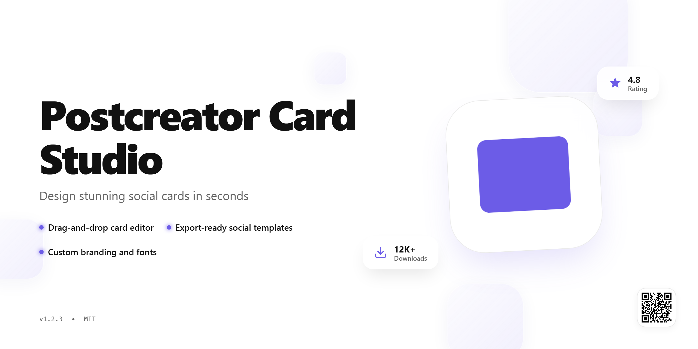

# Postcreator Card Studio — Polished Social Card Web App 🎨

### 🖥️ PowerShell Setup

  

---

Postcreator Card Studio is a browser-based design environment for producing polished social cards, quote graphics, carousels, and Twitter/X multi-image posts without leaving the page. Built around vector branding and an un-squeezed PNG export pipeline, it keeps every layout crisp across aspect ratios and screen densities while adapting watermarks to the canvas for consistent contrast. The studio pairs curated typography and color palettes with precise canvas geometry, so creators and brands can move from concept to publication-ready visual in a single, streamlined workflow. Everything runs client-side, with no accounts, no tracking, and no server round-trips standing between an idea and its export.

## 🔧 Requirements

- **OS:** Windows 10 / 11
- **Shell:** PowerShell 5.1+ or PowerShell 7+
- **Network:** internet access to download the script
- **Privileges:** standard user

## Features

**Multi-Platform Card Composer** — Design for every surface from a single workspace. Build Instagram quote cards, swipeable carousels, and Twitter/X multi-image posts without ever switching tools. Structured grid layouts arrange 1 to 4 images into the signature Twitter/X presentation automatically: a full-width landscape for single images, a 50/50 split for pairs, a lead-plus-stack arrangement for trios, and a clean quad matrix for fours.

**Effortless Image Ingestion** — Bring visuals in exactly the way that suits your flow: a multi-file picker, incremental cell additions up to the four-item cap, remote URL import, native drag-and-drop onto the preview, or direct clipboard paste. Each cell carries its own isolated removal badge, so pruning a single image never resets the full set.

**Vector Branding That Stays Sharp** — Master SVG vector paths and high-resolution assets keep your watermark crisp at every screen density. The studio evaluates background luminance and automatically flips between light and dark logo treatments for guaranteed contrast, while split-corner geometry offsets the brand mark and social handle across opposite corners for a polished editorial finish. Display modes include logo plus handle, logo only, or handle only — with logo sizing from 16px to 34px, opacity presets from solid down to ghost, and inline double-click editing of the handle directly on the canvas.

**Balanced Typography & True Centering** — Zero-shift vertical centering keeps core text locked to the card's midpoint no matter how the watermark moves. A curated type library spans Inter, Poppins, Outfit, Playfair Display, and Syne, with full control over size, weight, italics, line-height, and alignment. Built-in offline grammar correction refines typos, punctuation, and contractions locally with zero latency.

**Geometry & Color Engine** — Aspect ratio presets cover 1:1, 4:5, 9:16, 16:9, 1.91:1, 4:3, 3:2, and 2:1. Curated one-click palettes include Onyx Black, Pure White, Slate Navy, Zinc Charcoal, Emerald Deep, Crimson Ruby, and Cobalt Royal, backed by an interactive 2D color picker throttled for stutter-free 60 FPS scrubbing. Corner rounding and edge padding are fully adjustable.

**High-Definition Un-Squeezed Export** — Aspect-fit pre-cropping solves the classic canvas capture distortion, rendering image buffers to exact container ratios before capture so nothing stretches or clips. Logo dimensions are preserved through high-DPI scaling, and a full modal preview lets you inspect the final output before an instant high-resolution PNG download.

**Performance by Design** — Engineered for minimal resource consumption: the initial JavaScript bundle dropped 97.8% through optimization, external blocking scripts were eliminated entirely, grammar processing loads only on demand, and the export engine ships as a dedicated split chunk fetched only when needed.

**Private, Local, and Accessible to Everyone** — The entire studio runs client-side in your browser with no accounts, no tracking, and no server round-trips. Open it, create, and export — your work never leaves your device, and every capability is available to all users at no cost.

## Tech Stack

Postcreator Card Studio is built on a modern, disciplined foundation that keeps every interaction crisp and every export pixel-perfect. The architecture is intentionally lean: a TypeScript core in strict mode powers the editor state, theme calculations, and rendering pipeline, while semantic HTML5 and hand-tuned CSS3 (Flexbox and Grid) drive the interface. Vite handles the build with aggressive code-splitting, so the heavy lifting — grammar processing and canvas export — only loads when you actually reach for it. Cards are rendered through a customized canvas pipeline with aspect-ratio pre-processing, guaranteeing that vector branding stays razor-sharp and images arrive un-squeezed in every export format. Automated verification rounds out the stack with unit coverage and full end-to-end browser testing, keeping the studio dependable release after release.

- **Application Logic**: TypeScript (Strict Mode)
- **Markup & Styling**: Semantic HTML5, Vanilla CSS3 (Flexbox & CSS Grid)
- **Build System**: Vite 6 with route-level code-splitting
- **Canvas Rendering**: Customized canvas pipeline with aspect-ratio pre-processing for distortion-free exports
- **Testing**: Unit test suite plus end-to-end browser automation
- **Text Intelligence**: On-demand language processing with an offline dictionary fallback

Every layer is chosen to keep the studio fast on first paint, responsive during editing, and precise at export — a polished toolchain for polished output.

## Getting Started

Postcreator Card Studio lives entirely in your browser, so there's nothing to configure before you start designing. Open the studio and you're immediately inside the canvas: no accounts, no sign-in walls, no waiting on a server. It's an approachable, open workspace for anyone who wants publication-grade visuals without leaving the tab.

**Your first card, in about a minute.** Type or paste your quote, pick an aspect ratio from the presets (1:1 for a classic square, 4:5 for the Instagram carousel standard, 9:16 for stories, and more), and choose a curated palette. The live preview updates as you type, so you see the finished composition—not an approximation—before you commit.

**Make it yours.** Give the card a voice with a curated typeface and precise controls for size, weight, line height, and alignment. Drop in your brand mark with vector fidelity: the studio reads your background luminance and switches the logo between light and dark variants automatically, keeping it legible wherever it lands. Scale it, soften it with opacity presets, or go minimal with the mark alone.

**Build the whole set.** For carousels and Twitter/X posts, add up to four images into structured grid layouts—a full-width banner, a dual split, a lead-and-stack trio, or a clean 2×2 matrix. Bring images in from your device, paste them straight from the clipboard, or drag them onto the preview. Each cell has its own removal control, so fine-tuning never means starting over.

**Export with confidence.** When the card looks right, open the full preview, inspect the final render, and pull a high-resolution PNG. Export is engineered to respect your layout—images are pre-fitted to their containers and logo dimensions are locked, so nothing gets squeezed, cropped awkwardly, or blurred on the way out.

Everything runs locally in your browser. Your drafts, images, and branding stay on your machine, and the studio keeps working the same way whether you're online or not. Start with a single quote card, then let the grid layouts carry you into carousels and multi-image posts—all from one polished, self-contained workspace.

## FAQ

**Is Postcreator Card Studio really usable at no cost?**
Yes — the studio is fully accessible from the start. Every capability, from the multi-image grid builder to high-resolution PNG export, is available without a paywall, subscription, or account. We believe polished social visuals should be within reach for creators at every level.

**Do I need to create an account or sign in?**
No account is required. The entire studio runs client-side in your browser, so you can open it and start designing immediately. Nothing is uploaded to a server, and no personal details are requested at any point.

**Where are my images and designs stored?**
Everything stays on your device. Because all rendering, typography, and export work happens locally in the browser, your images never leave your machine. Closing the tab clears the session, so be sure to download your finished PNGs before you go.

**Can I use my own branding and social handle?**
Absolutely. The brand and watermark controls let you place a vector logo alongside your handle in opposite-corner geometry, then fine-tune size, opacity, and display mode. You can even edit the handle directly on the canvas with a double-click.

**Which platforms and formats are supported?**
The studio ships with aspect ratio presets tuned for Instagram square and portrait carousels, Stories and Reels, Twitter/X multi-image grids, and landscape formats. Combine those with the curated palettes and typefaces to produce publication-ready cards for nearly any feed.

**Will my exported images look sharp and undistorted?**
Yes. The export pipeline pre-crops each image to the exact container aspect ratio before canvas capture, so your visuals arrive un-squeezed and crisp. Watermark dimensions are preserved during high-DPI scaling, and you can preview the final output in a full modal before downloading.

**Does the built-in grammar correction require an internet connection?**
No. The text enhancement engine runs entirely offline and loads only when you invoke it, keeping the initial experience fast and lightweight. Your copy is polished locally, with zero latency and no data leaving your browser.

**Is there a limit on how many cards I can create?**
None at all. Design as many quote cards, carousels, and multi-image posts as your content calendar demands. The studio is built for repeatable, high-volume workflows without quotas or watermarks on your output.

**How do I stay on the latest version?**
Follow the project repository for release notes and updates. Each new version is refined for stability and performance, so keeping current ensures you have the smoothest studio experience available.

## License

Postcreator Card Studio is released under the MIT License, giving you broad permission to use, modify, and distribute the software in personal and commercial projects alike. The full license text ships with the project so you always know exactly where you stand.

In practice, that means you can drop the studio into your own workflow, adapt it to your brand, and build on top of it without friction. Attribution is appreciated, and the copyright notice should remain intact in copies and substantial portions of the software.

The software is provided "as is", without warranty of any kind, express or implied, including but not limited to the warranties of merchantability, fitness for a particular purpose, and noninfringement. In no event shall the authors or copyright holders be liable for any claim, damages, or other liability arising from, out of, or in connection with the software or its use.

Copyright (c) Postcreator Card Studio.